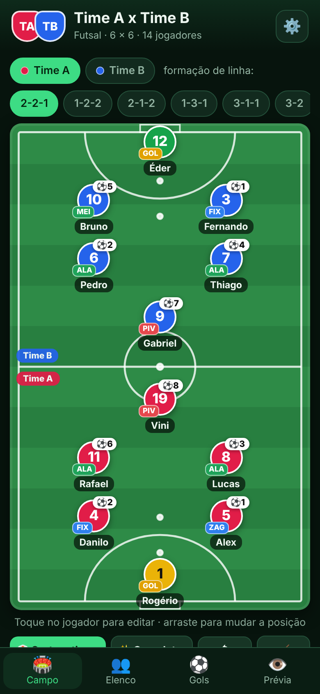
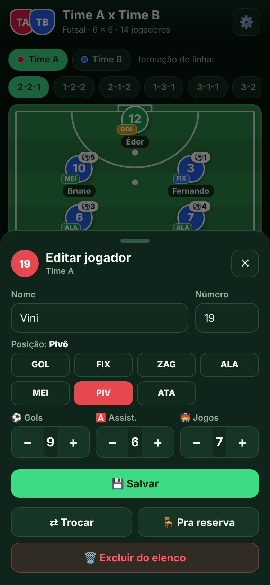
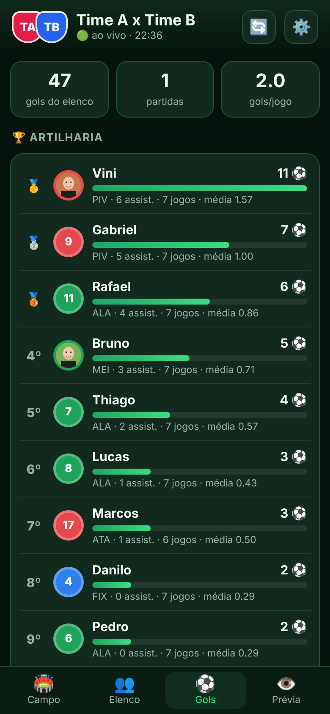
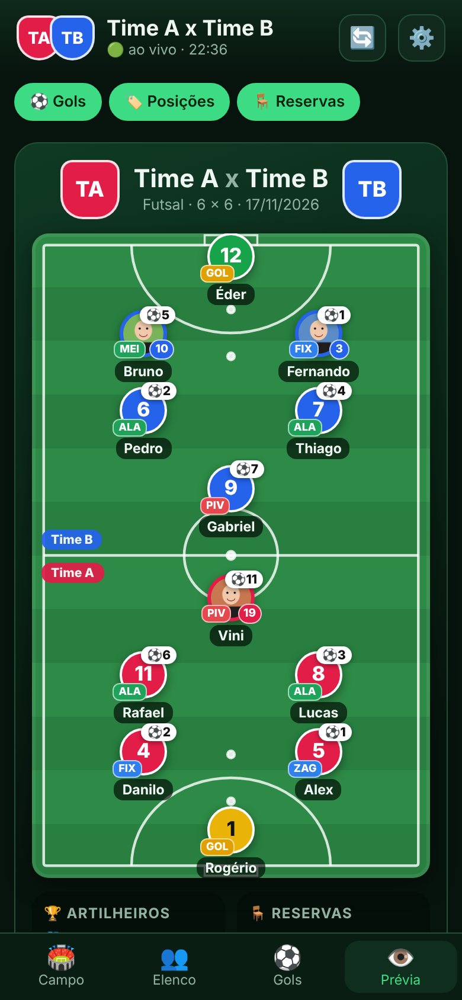

<p align="center"></p>

<h1 align="center">JA Escalação</h1>
<p align="center">App Android para montar a escalação do futsal — <b>6 de cada lado (goleiro + 5 na linha)</b>, editar jogadores, controlar gols e ver a prévia dos times.</p>

<p align="center"><b>⬇️ <a href="https://github.com/jadilson25a-dotcom/ja-escalacao/raw/main/apk/JA-Escalacao.apk">Baixar o APK (v1.1)</a></b></p>

| Quadra | Editar jogador | Artilharia | Prévia |
|---|---|---|---|
|  |  |  |  |

## Funções

- **Quadra com os dois times** (Time A embaixo, Time B em cima), cada um com goleiro + 5 na linha.
- **Formações de linha:** 2-2-1, 1-2-2, 2-1-2, 1-3-1, 3-1-1, 3-2 e 2-3 — cada time escolhe a sua.
- **Toque no jogador** para editar nome, número, posição (GOL, Fixo, Zagueiro, Ala, Meia, Pivô, Atacante), gols, assistências e jogos. **Arraste** para mudar a posição na quadra.
- **🎲 Sortear times:** um goleiro para cada lado e o resto dividido de forma equilibrada pelos gols.
- **Reservas / próximos:** escolha em qual time e no lugar de quem o reserva entra.
- **Base de gols:** ranking de artilharia, registro de partidas Time A x Time B com quem marcou (o placar sobe sozinho), excluir partida desfaz os gols.
- **Prévia:** cartão com os dois times na quadra, artilheiros e reservas — pronto para print e mandar no grupo.
- **Times:** nome, cor do colete e cor da camisa do goleiro de cada time.
- **Backup** por texto (copiar e restaurar) e funciona **100% off-line** — os dados ficam salvos no celular.

## Como instalar

1. Baixe o [JA-Escalacao.apk](https://github.com/jadilson25a-dotcom/ja-escalacao/raw/main/apk/JA-Escalacao.apk) (fica na pasta `apk/`).
2. Abra o arquivo no celular e permita **“instalar apps desconhecidos”** quando o Android pedir.
3. Requer Android 7.0 ou mais novo.

## Como é feito

O app é uma página HTML/JS ([`app/assets/index.html`](app/assets/index.html)) rodando dentro de um WebView Android.
O script [`app/build_apk.py`](app/build_apk.py) monta o APK sem precisar do Android Studio: gera o `classes.dex`, o `AndroidManifest.xml` binário, o `resources.arsc` com o ícone, alinha o zip e assina com APK Signature Scheme v2.

```bash
pip install pillow cryptography
python3 app/build_apk.py JA-Escalacao.apk
```

A chave de assinatura é criada em `app/keys/` na primeira vez e **não vai para o repositório**.

---
Feito por **Jadilson Alves**.
